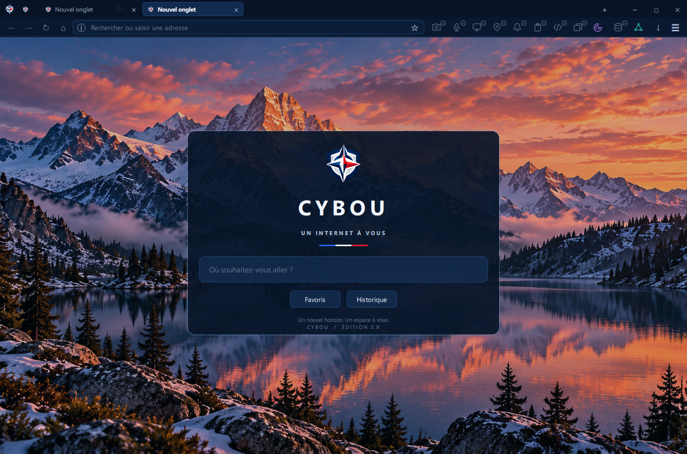

<p align="center">
  
</p>

<h1 align="center">CYBOU Browser</h1>

<p align="center">
  <strong>See what a page requests. See what gets blocked. Control what it can do.</strong>
</p>

<p align="center">
  <em>Observable Browsing · Observe → Restrict → Control → Revoke</em>
</p>

<p align="center">
  <a href="docs/PRODUCT_VISION.md">Product vision</a> ·
  <a href="docs/CONTROL_BAR_UX.md">Control Bar UX</a> ·
  <a href="docs/SECURITY_MODEL.md">Security model</a> ·
  <a href="docs/ROADMAP.md">Roadmap</a>
</p>

<p align="center"><sub>Development preview · v0.8.0</sub></p>

---



<p align="center"><sub>Actual CYBOU 0.8 start-page capture from the repository — the Alpine Dawn default page, with the inline capability controls in the browser navigation row.</sub></p>

## A browser built around what pages **do**

Conventional browser chrome gives the address bar most of the attention, while the permissions that matter are often hidden behind menus and prompts. **CYBOU reverses that priority.**

The main interface is a **permanently visible, single-row Control Bar**. Its individual icons show which capabilities a page can use, which requests the browser actually observed, and what was blocked. Supported controls act directly on a click. Hover opens a glass panel containing contextual explanations and supported controls, without requiring a click.

The full URL is always available for inspection and editing, but **the address bar never displaces the capability controls**. Page identity remains important for origin isolation and anti-spoofing; an HTTPS address alone is not proof that a site is trustworthy.

### Non-negotiable principles

- **Visible controls first.** Keep all eleven main capability icons in the **same navigation row** as the address, which fills remaining width. Do not replace them with three group buttons or move the Control Bar to another row.
- **One-click interaction.** A supported policy changes immediately, or a click acts on an actual pending permission request. Capabilities without a safe direct action open explanatory details instead.
- **No permanent positive trust.** A previous visit does not earn future camera, microphone, geolocation, or other sensitive permissions. There is no “Always allow this site” privilege.
- **No user-facing ASK workflow.** A page request highlights the relevant control. The browser does not interrupt ordinary browsing with a routine permission dialog.
- **Conservative by default.** Sensitive capabilities are unavailable until explicitly granted; defensive network rules are enabled by default. Any relaxation must be deliberate and limited.
- **Truthful observability.** A policy, a request, a grant, a blocked attempt, and actual device activity are distinct facts. A grant is **not** evidence that a camera or microphone is recording.

The normative definitions are in [Product Vision](docs/PRODUCT_VISION.md), [Security Model](docs/SECURITY_MODEL.md), and [Capability Contract](docs/CAPABILITY_CONTRACT.md).


## Your page, your controls

**Eleven individual capabilities are visible in the existing navigation row:**

| Capability | Current implementation |
| --- | --- |
| **Camera / Microphone** | Highlight actual WebEngine permission requests; grant a still-valid request by clicking its icon. A grant is not proof of active capture. |
| **Screen sharing** | Marked unavailable while the capture chooser is not integrated. Unsupported requests are denied. |
| **Geolocation** | Observe and handle supported permission requests; a functional physical-location backend has not been verified. |
| **Notifications** | Observe and handle permission requests; native desktop notification delivery is not integrated. |
| **Clipboard** | Handle supported WebEngine permission requests; not all clipboard activity is observable. |
| **JavaScript** | Toggle the page's behavior policy; offer Reload / Undo when needed. |
| **Pop-ups** | Control future window-opening behavior; user-initiated actions are allowed by default. |
| **Cookies** | Display the current third-party-cookie policy. Filtering is **profile-wide**, not a per-site switch. |
| **Site storage** | Control the WebEngine localStorage setting; not comprehensive IndexedDB, Cache Storage, or service-worker management. |
| **Network** | Human-readable resource types and filter decisions, HTTP/tracker/other categories, bounded profile-scoped samples. A temporary tracker exception recreates one HTTPS document in a separate off-the-record profile, with explicit revocation. |

**An icon has two independent jobs:** indicate the effective policy and signal a confirmed event. A pending request is visually distinct from an allowed capability, a blocked attempt, and recent activity. Glass hover panels identify the relevant scope and requesting origin when available.

### Permission lifecycle in the current build

1. A foreground page requests a supported sensitive capability; the corresponding icon highlights **without a routine ASK dialog**.
2. Clicking a highlighted icon may grant **the current, valid request**. Unanswered requests are denied after **15 seconds**.
3. Regular and private WebEngine profiles use **AskEveryTime** internally; they do not persist positive grants to disk.
4. Each grant belongs to the current document. Reload, navigation, tab closure or explicit reset end that access; revocation may replace the WebEngineView. A grant is not evidence of active hardware use.
5. Another visit requires a new permission decision; no permanent positive site trust is retained.

A request's top-level site and actual requesting origin may differ (for example, in an iframe). This needs further real-world verification with combined camera/microphone requests, multiple tabs, and physical devices.

## Security and network protection

| Area | Shipped in the code | Planned / unverified |
| --- | --- | --- |
| **Encrypted transport** | Production HTTPS strict; exact HTTP consent in a separate off-the-record profile. Legacy global opt-outs removed; certificate errors rejected. | Real-world transport compatibility and OS suspend/resume checks. |
| **Tracker filtering** | A small in-memory list of known advertising and analytics host suffixes blocks selected third-party requests. | Comprehensive, versioned ad/tracker rules and verified category separation. |
| **Observable traffic** | Bounded, sanitized metadata with origin, resource type, timestamp, blocked outcome, and reason. | Guaranteed per-tab attribution and visibility into all page/JavaScript activity. |
| **Permission restrictions** | Native C++ coordinator, request identity checks, fail-closed pending timeout and document-scoped grants. | Proven hardware capture-stop behavior on real devices. |
| **Risk-adaptive mode** | Conservative WebEngine content policies and the transport/request interceptor. | Evidence-based risk engine and JS-off applied before suspicious content loads. |
| **Proxy isolation** | **Not implemented.** | Dedicated, tested network/process isolation including DNS and WebRTC leak checks. |

An unfamiliar website is not automatically malicious. CYBOU must base stronger restrictions on specific evidence and must never pretend that simply using a proxy makes a malicious page safe.

**Security disclosure:** CYBOU is an experimental browser, not independently security-audited. The current suffix-list filter is **not** a complete ad blocker. Network observation cannot reveal every action executed by a page. Private mode does not anonymize the connection. Keep the underlying Qt/Chromium engine patched.


## Temporary HTTP and tracker exceptions

### HTTP: exact-address consent

Production HTTPS strict is always enabled; legacy global opt-outs and host-wide fallback are removed. After a blocked HTTP attempt or failed known HTTPS upgrade, the Network panel offers explicit access to that exact address. Consent creates a separate off-the-record profile without normal cookies/cache for this document. One exact main-frame URL and same-origin HTTP resources with matching firstParty are allowed. Other HTTP origins and ws remain blocked. Reload, later navigation, tab closure and manual revoke end the temporary view/profile; HTTP requires fresh consent. Page-controlled navigation is never automatically replayed with normal cookies. This separates profile data, not processes or proxy routes.

The static tracker suffix list is a limited network filter. Risk-adaptive restrictions and verified proxy isolation remain planned. See [validation](docs/VALIDATION.md) for native HTTP, permission lifecycle and hover-panel evidence.

The connection indicator becomes an HTTP consent/revoke button when applicable. A vertical separator divides the capability controls from downloads. Drag the unused tab-strip area to move the window; double-click it to maximize or restore the previous size.

### Trackers: dedicated temporary context

The Network glass panel groups HTTP, tracker and other events, using resource names and clear explanations. Passing a filter is not proof of a successful load. Counts are scoped to the current profile's recent sample.

If filtering breaks a loaded HTTPS page, explicit consent recreates that exact page in a separate off-the-record profile without ordinary cookies/cache. Tracker-list requests with matching firstParty origin can pass while that temporary document remains active. Existing behavior restrictions are inherited, while device grants are not copied. The panel provides immediate revocation of the temporary exception. Reload, later navigation, tab closure or manual revoke end the temporary context; other tabs retain tracker filtering. This mode does not combine with HTTP exceptions. See [ADR 0004](docs/ADR/0004-temporary-tracker-exceptions.md).

## Security and UX: what we are building next

The **single-row eleven-icon Control Bar and interactive glass hover panels remain unchanged**. The next priorities are iframe deny inheritance, a reliable media-permission lifecycle without silent page loss, WebEngine patch/sandbox discipline, full ad/tracker rule coverage, independent site-scoped controls, truthful activity and navigation risk checks.

The existing tracker-only temporary context is implemented, but the full rule engine and independent ad/tracker category controls are **planned**. Permission grants do not prove active hardware use; profile network events are not per-tab statistics. See the [Security & UX plan](docs/SECURITY_UX_EVOLUTION.md) and [Roadmap](docs/ROADMAP.md).

## Everyday browser features

The current application also includes draggable/reorderable tabs; pinned and muted tabs; bookmarks and history; local address suggestions; private windows with independent off-the-record profiles; a download library with an explicit review before external opening; PDF export; find in page; local file opening; and configurable search providers.

The browser-owned UI uses the CYBOU navy/red/white brand and the Dark Glass / Alpine Dawn design language. The application icon is [assets/cybou.png](assets/cybou.png); the Windows executable icon is [assets/cybou.ico](assets/cybou.ico).

**No permanent site permission does not mean no local data is saved.** Bookmarks, history, session URLs, cookies, downloaded files, and ordinary first-party storage can persist. History and session URLs are saved in QSettings without encryption. The current cleanup command does not comprehensively erase localStorage, IndexedDB, or service workers.

## Build on Windows

**Build requirements:** a C++20-capable compiler, CMake 3.24+, and Qt 6.9+ with Quick, Quick Controls 2, WebEngine Quick/Core, Network, LinguistTools and Test. The recorded Windows validation includes a successful C++20 Release build and security suite with Qt 6.12.0 and MSVC 2022 x64 (19.44); this is not an independently audited release.

```powershell
cmake -S . -B build -G "Visual Studio 17 2022" -A x64 -DCMAKE_PREFIX_PATH=C:/Qt/6.12.0/msvc2022_64
cmake --build build --config Release --parallel 4
C:/Qt/6.12.0/msvc2022_64/bin/windeployqt.exe --release --qmldir qml --no-translations build/Release/cybou.exe
./build/Release/cybou.exe
```

Linux and macOS may use their corresponding Qt kits, but builds, packaging, and integrations are **not yet verified**. Installer, automatic security updates, crash recovery, and release-grade platform validation remain outstanding.

### Keyboard shortcuts

| Shortcut | Action |
| --- | --- |
| Ctrl+L | Edit the full URL |
| Ctrl+T / Ctrl+W | New tab / close tab |
| Ctrl+Shift+T | Reopen closed tab |
| Ctrl+Tab / Ctrl+Shift+Tab | Switch tabs |
| Ctrl+R | Reload |
| Ctrl+F / Ctrl+J | Find on page / downloads |
| Ctrl+D / Ctrl+H | Bookmark / history |
| Ctrl+Shift+N | Private window |
| Ctrl+, | Settings |
| Ctrl+O / Ctrl+P | Open local file / export PDF |
| F11 | Fullscreen |

## Tests

Use the built-in local fixtures for deterministic regression checks:

```powershell
./build/Release/cybou.exe --tracker-test
./build/Release/cybou.exe --transport-test
./build/Release/cybou.exe --security-test
./build/Release/cybou.exe --controlbar-test
./build/Release/cybou.exe --smoke-test
./build/Release/cybou.exe --surface-test
```

These suites exercise policy rules, layout and interaction, and browsing workflows. The test harness also produces local screenshots. Passing a local suite is **not** equivalent to verifying permissions on real devices or auditing web-engine security. See the [Capability Audit](docs/API_CAPABILITY_MATRIX.md) and [Roadmap](docs/ROADMAP.md) for gaps.

## Documentation

| Read | Purpose |
| --- | --- |
| [Product Vision](docs/PRODUCT_VISION.md) | CYBOU's purpose and fixed principles |
| [Security Model](docs/SECURITY_MODEL.md) | Threat boundaries and permission lifecycle |
| [Capability Contract](docs/CAPABILITY_CONTRACT.md) | Observable events and truthful controls |
| [Control Bar UX](docs/CONTROL_BAR_UX.md) | Permanent, inline **single-row** interaction rules |
| [Architecture](docs/ARCHITECTURE.md) | WebEngine, observation, models and QML |
| [Roadmap](docs/ROADMAP.md) | Implementation state and verification gates |
| [Security & UX Evolution (RU)](docs/SECURITY_UX_EVOLUTION.md) | Current security/UX direction, planned features and test gates |
| [Engineering proposal (RU)](docs/OBSERVABLE_BROWSING_PROPOSAL_RU.md) | Detailed plan — not a report of completed features |

Older design mockups and integration reports are retained in the repository for history. The documents above describe the current product direction.

---

<p align="center">
  <strong>CYBOU — Observe. Restrict. Control. Revoke.</strong><br />
  <sub>A capability-first browser designed to make page behavior visible — not to ask for blind trust.</sub>
</p>