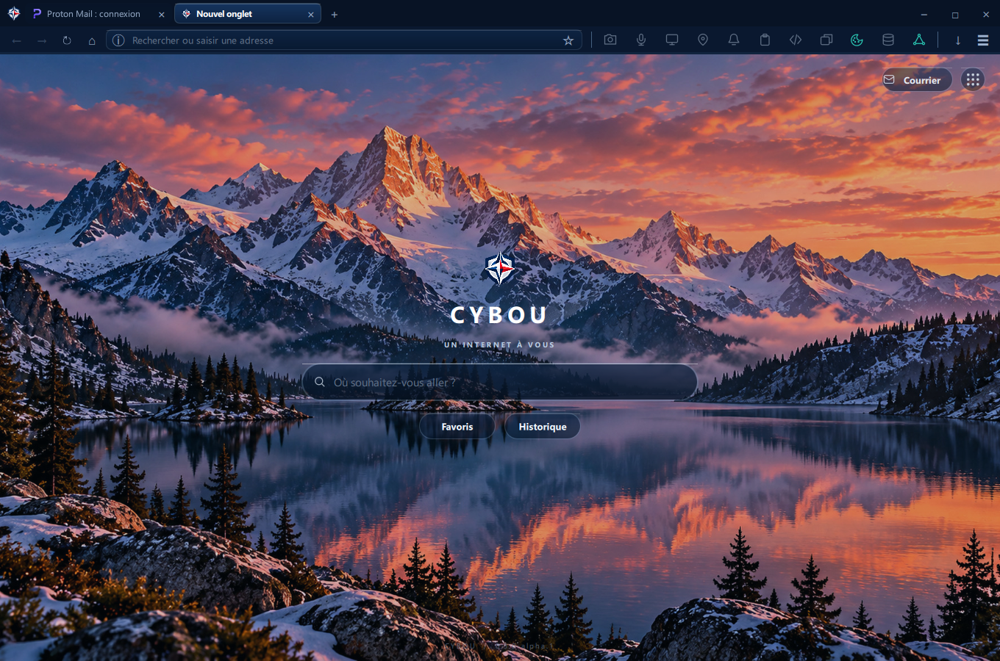

<p align="center">
  
</p>

<h1 align="center">CYBOU Browser</h1>

<p align="center"><strong>Observe → Restrict → Control → Revoke</strong></p>
<p align="center">A native C++20 / Qt Quick / Qt WebEngine browser for visible, direct control over website capabilities.</p>
<p align="center"><strong>Current source: 0.3.0-alpha.1 · Development only · No public release yet</strong></p>

## Engineering showcase and open source

CYBOU is a real browser project **and** an inspectable case study in C++20/Qt software and systems architecture. The implementation, decisions, trade-offs, test boundaries and remaining risks are available to reviewers.

- [Architecture overview](docs/ARCHITECTURE_OVERVIEW.md) — components, trust boundaries and permission lifecycle
- [Engineering decisions](docs/ENGINEERING_DECISIONS.md) — alternatives, constraints and trade-offs
- [Engineering quality](docs/ENGINEERING_QUALITY.md) — source, tests, evidence levels and known gaps
- [Étude de cas en français](docs/CASE_STUDY_FR.md) — concise professional overview

Open source means the code can be inspected and contributed to. **It does not mean this alpha is a qualified secure browser.** See [security reporting](SECURITY.md), [contributing](CONTRIBUTING.md) and [validation](docs/VALIDATION.md).

## Current interface

<p align="center">
  
</p>
<p align="center"><sub>CYBOU on Windows · Alpine Dawn new tab · Actual application screenshot (1360 × 900)</sub></p>

## Current implementation

CYBOU runs as a Windows desktop browser with a two-row window header (tabs and navigation). The navigation row contains a URL field plus **11 permanently visible, individual capability controls**: Camera, Microphone, Screen, Location, Notifications, Clipboard, JavaScript, Popups, Cookies, Site Storage and Network. Glass hover cards provide context and relevant actions. A policy state, observed request, granted permission, confirmed block and actual hardware use are **different facts**.

**Alpine Dawn (new tab)** currently uses the mountain wallpaper, a compact floating brand/title, a separate glass search input, Favorites/History actions, and a top-right **Mail + nine-dot Cloud App Launcher**. The launcher uses Cloud Glass 2.0, local SVG icons and a provider-neutral catalog. It shows the selected cloud apps and opens their official websites as ordinary tabs. The screenshot above shows the current Windows new-tab UI with the cloud launcher closed.

**Cloud services** have a C++ catalog/manager, QML settings, default Proton suite, per-service provider overrides, Google, Microsoft 365, Infomaniak, Zoho, Nextcloud and additional web shortcuts. Proton Pass, Lumo and Wallet are **web shortcuts only**: there is no password-manager integration or privileged API access. Self-hosted Nextcloud needs a user-supplied HTTPS URL. Cloud-account login/2FA and cross-provider interoperability are **not fully qualified** on this build.

**Daily browsing** includes tabs, bookmarks, history, local address suggestions, downloadable-file review, PDF export, in-page search, private browsing profiles, configurable search engines and French/Russian UI support. Individual features require additional integration and accessibility verification before 1.0.0.

## Security: implemented behavior versus proof

| Area | Present in source | Not yet demonstrated as release-grade |
| --- | --- | --- |
| Permissions | Native C++ request coordinator, origin/document context, expiry/cancel/revoke and per-site Control Bar actions | Complete hardware capture/revoke, iframe/redirect adversarial matrix, exhaustive negative tests |
| HTTPS | Strict HTTPS policy, certificate-error handling and explicit exact-address temporary HTTP context | Complete certificate/network/DNS/WebRTC attack coverage |
| Network controls | Request observer, categorized local ad/tracker rules, origin-scoped temporary exceptions and network event summaries | Comprehensive blocklists, false-positive testing, DNS/PNA bypass resistance and performance under attack |
| Private browsing | Separate off-the-record WebEngine profile | Independent process/network isolation or anonymity (not claimed) |
| Cloud launch | Local catalog, provider overrides, official HTTPS navigation and local SVG resources | Verified login/2FA/SSO for every supplier; no extra site permissions are granted |
| Test engineering | Six native/integration test suites, local OWASP-oriented runner and risk-case inventory | Official OWASP inventory mapping, complete executed evidence, independent security assessment |
| Distribution | Windows CMake/Qt build configuration | Signed installer, security update/rollback channel and independently verified shipped sandbox |

**CYBOU is not yet a publicly released or security-certified browser.** No blanket anti-phishing, full adblocking, complete JavaScript monitoring or immunity from compromised sites is claimed. Test plans are not test results.

### Non-negotiable product rules

- All eleven capability icons stay in **one existing navigation row**; do not hide or group them to create space for cloud apps.
- No permanent positive grants or automatic privileged trust for previously visited websites.
- A cloud partnership, including Proton, **does not change browser permissions or security policy**.
- **No third-party browser extensions, extension store, side-loading or privileged userscripts.** Capabilities inspired by other browsers should be implemented in reviewed CYBOU-owned C++/Qt/QML. External executables and runtime dependencies are minimized.
- The browser does not secretly access Mail/Drive accounts or collect cloud-service tokens to populate the launcher.

See [Product Vision](docs/PRODUCT_VISION.md), [Security Model](docs/SECURITY_MODEL.md), [Capability Contract](docs/CAPABILITY_CONTRACT.md), [Cloud contract](docs/ADR/0007-selectable-cloud-services.md) and [Extension ban](docs/ADR/0006-no-third-party-extensions.md).

## Build and run

Build target: **Windows x64**, C++20, CMake 3.24+, Qt 6.12 / MSVC 2022 (Qt 6.9+ API baseline; current build uses Qt 6.12). Required Qt components: Quick, Quick Controls 2, WebEngine Quick/Core, Network and LinguistTools. Qt Test enables the separate test executable.

```powershell
cmake -S . -B build -G "Visual Studio 17 2022" -A x64 -DCMAKE_PREFIX_PATH=C:/Qt/6.12.0/msvc2022_64
cmake --build build --config Release --parallel 4
C:/Qt/6.12.0/msvc2022_64/bin/windeployqt.exe --release --qmldir qml --no-translations build/Release/cybou.exe
.\build\Release\cybou.exe
```

The production executable is §cybou.exe§; §cybou_tests.exe§ is the separate test runner. The program version originates in CMake and is also displayed on the new tab.

## Testing

```powershell
python tools/security/test_owasp_gate.py
python tools/security/owasp_gate.py --mode baseline --exe build/Release/cybou_tests.exe --out build/security-baseline.json
```

The baseline executes security, controlbar, transport, tracker, surface and smoke suites and saves results. The `--mode release` gate also requires pinned full OWASP ASVS/WSTG inventories, explicitly reviewed applicability, real test logs tied to source/binary hashes and all browser-specific cases. **It is presently blocked by missing coverage/evidence; no 1.0.0 GO decision has been made.** No test result is asserted here without an available current-build report.

See [Security Verification Framework](docs/SECURITY_VERIFICATION_FRAMEWORK.md), [Test Plan](docs/TEST_PLAN.md), [Validation Status](docs/VALIDATION.md), [Threat Model](docs/THREAT_MODEL.md) and [1.0.0 Release Criteria](docs/RELEASE_CRITERIA.md).

## Road to 1.0.0

| Source-version stage | Promotion requirement |
| --- | --- |
| **0.3.0-alpha.1 — NOW** | Architecture/product implementation exists; not qualified |
| **0.4.0-alpha.N** | Official OWASP inventories pinned, full applicability and reproducible test infrastructure |
| **0.5.0-alpha.N** | Browser hardening, fuzzing, negative/system/hardware coverage and high-risk fixes |
| **0.6.0-beta.N** | Feature freeze, end-to-end Windows qualification, accessibility and compatibility |
| **1.0.0-rc.N** | Independent security review, complete current-candidate evidence and signed distribution rehearsals |
| **1.0.0** | First public Windows x64 release after all gates pass |

For concrete deliverables and go/no-go rules, use [Roadmap](docs/ROADMAP.md), [Versioning](docs/VERSIONING.md) and [Release Criteria](docs/RELEASE_CRITERIA.md).

## Documentation

[Documentation index](docs/DOCUMENTATION_INDEX.md) · [Architecture](docs/ARCHITECTURE.md) · [Control Bar UX](docs/CONTROL_BAR_UX.md) · [Cloud Compatibility](docs/CLOUD_COMPATIBILITY_MATRIX.md) · [OWASP Security Framework](docs/SECURITY_VERIFICATION_FRAMEWORK.md)

## License and third-party materials

Original CYBOU Browser source code is available under the [Apache License 2.0](LICENSE). See [NOTICE](NOTICE) and [third-party licensing notes](THIRD_PARTY_NOTICES.md). Qt/Chromium dependencies, provider marks and individual media assets may have separate terms. Licensing the source does **not** equal releasing a tested installer.

---

<p align="center"><strong>CYBOU — An Internet of Your Own.</strong></p>
