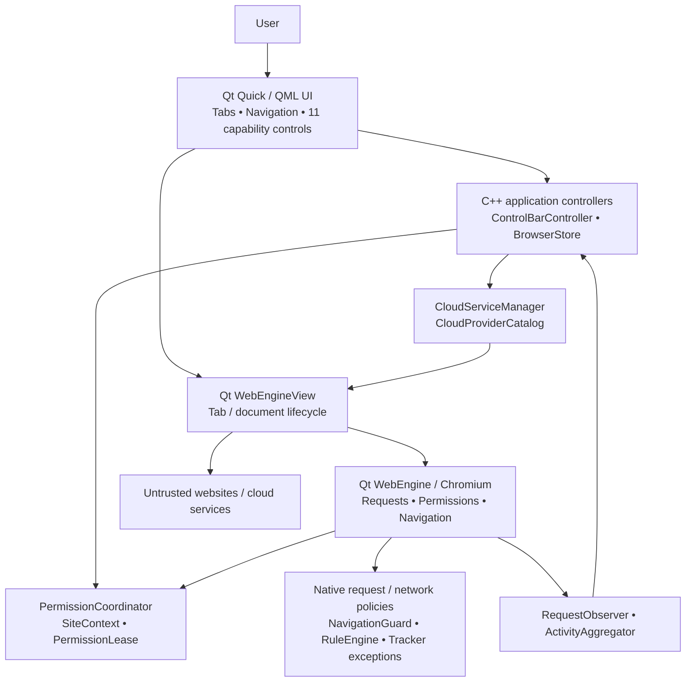
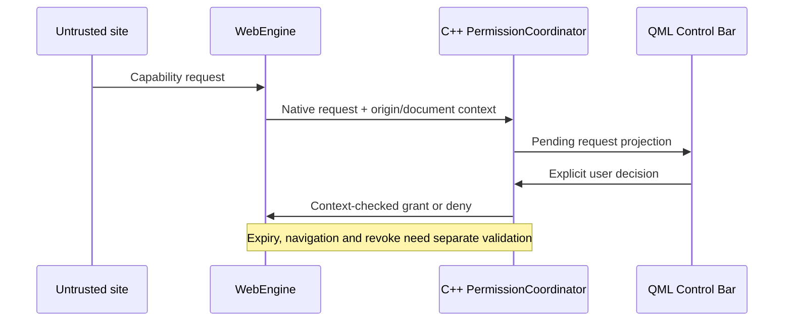

# CYBOU Browser — Architecture overview

**Audience:** external engineers, architectural reviewers and potential collaborators.  
**Baseline:** C++20 / Qt 6 Quick, QML, Qt WebEngine. Current project source **0.3.0-alpha.1**. Windows is the development target; this is not a release qualification document.

## Why the architecture exists

CYBOU Browser is a desktop browser that makes site capabilities visible, revocable and inspectable. The core architectural question is how to let a user control web-origin permissions **without confusing a UI toggle with a browser-engine-enforced result**.

## C4-style runtime sketch (simplified)

This is a conceptual map. Real object ownership, event ordering and engine restrictions must be verified in [source architecture](ARCHITECTURE.md), implementation and [tests](TEST_PLAN.md).

## Major responsibilities and source locations

| Responsibility | Current source / documentation |
| --- | --- |
| Application shell, tabs and navigation | `qml/Main.qml`, `qml/BrowserTab.qml` |
| New tab and user-facing cloud shortcuts | `qml/NewTabPage.qml`, `qml/CloudAppLauncher.qml` |
| Browser settings, profiles, storage state | `src/browserstore.h` |
| Native permission request ownership / lifecycle | `src/security/PermissionCoordinator.cpp`, `SiteContext.h`, `PermissionLease.h` |
| User controls, state/projection | `src/controlbar/ControlBarController.cpp`, `qml/ControlBarInline.qml` |
| Network decisions and observed activity | `src/security/NavigationGuard.h`, `RuleEngine.h`, `TrackerExceptionRegistry.h`, `src/activity/ActivityAggregator.cpp` |
| Cloud catalog / provider preferences | `src/cloud/CloudProviderCatalog.cpp`, `CloudServiceManager.cpp` |
| Native fixtures and gates | `tests/`, `tools/security/`, `docs/VALIDATION.md` |

## Critical trust boundaries

1. **Untrusted web content vs browser-owned code.** A website, frame or cloud partner cannot become a trusted caller merely through its address or identity.
2. **Native request vs user-facing policy.** A request is identified by the top/requesting origin, tab/view/profile and navigation epoch; an icon state is not sufficient evidence of an effective grant.
3. **Policy vs observations.** Pending request, granted permission, confirmed block and actual hardware use are distinct facts. Not every requested capability has an equally complete native enforcement path yet.
4. **Temporary HTTP vs regular browsing.** The exceptional exact-address HTTP flow uses an off-the-record profile with its own lifetime; it is not a separate OS-process or proxy sandbox.
5. **Network scope.** The request interceptor and some observations are profile-scoped. Do not claim perfect per-tab attribution or comprehensive tracker blocking.
6. **Cloud integration.** Provider choice opens standard HTTPS web applications; it does not imply native API access, login interoperability or privileged treatment.

## Data and control flow: site permission

## Alternatives and deliberate non-goals

- **No extension runtime.** The application implements reviewed, browser-owned capability controls rather than allowing arbitrary privileged extension packages. [ADR 0006](ADR/0006-no-third-party-extensions.md).
- **No special trust for providers.** Proton, Google, Microsoft and other shortcuts are regular websites. [ADR 0007](ADR/0007-selectable-cloud-services.md).
- **No unsupported security claims.** Full sandbox, real hardware revocation, comprehensive DNS/WebRTC/PNA coverage and signed release qualification remain separately gated.

## Where to go next

[Detailed source-oriented architecture](ARCHITECTURE.md) · [Engineering decisions](ENGINEERING_DECISIONS.md) · [Capability contract](CAPABILITY_CONTRACT.md) · [Security model](SECURITY_MODEL.md) · [Engineering quality](ENGINEERING_QUALITY.md) · [French case study](CASE_STUDY_FR.md)
